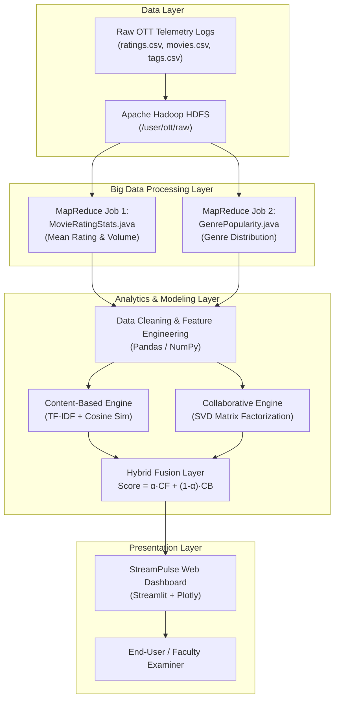

# A PROJECT REPORT ON
## DESIGN AND IMPLEMENTATION OF A PERSONALIZED OTT MOVIE AND WEB SERIES RECOMMENDATION SYSTEM USING BIG DATA ANALYTICS

**Subject Code:** BCS714D (Data Analytics)  
**Academic Year:** 2026–2027  

---

## 1. TITLE PAGE

```
                     A PROJECT REPORT
                            ON
   DESIGN AND IMPLEMENTATION OF A PERSONALIZED OTT MOVIE 
     AND WEB SERIES RECOMMENDATION SYSTEM USING BIG DATA
                          ANALYTICS

                 Submitted in partial fulfillment of 
                     the requirements for the 
                 Subject: Data Analytics (BCS714D)

                             Submitted by:
                 [Student Name]           [USN]

                      Under the Guidance of:
                    [Internal Guide Name]
                    [Designation / Department]

                DEPARTMENT OF COMPUTER SCIENCE & ENGINEERING
                     [COLLEGE / UNIVERSITY NAME]
                            [CAMPUS CITY]
```

---

## 2. ACKNOWLEDGEMENT

I express my profound gratitude to our respected Principal, **[Principal Name]**, and the Head of the Department of Computer Science & Engineering, **[HOD Name]**, for providing excellent computational facilities and academic ambiance.

I express my sincere thanks to my guide, **[Guide Name]**, for their invaluable guidance, encouragement, constructive criticism, and continuous support throughout the duration of this project.

Finally, I wish to extend my appreciation to all faculty members, technical staff, friends, and family who directly or indirectly aided in the successful completion of this project.

**[Student Name]**  
USN: [Your USN]  

---

## 3. ABSTRACT

With the exponential growth of digital media and Over-The-Top (OTT) streaming platforms such as Netflix, Amazon Prime, and Disney+ Hotstar, users are faced with millions of titles, leading to significant choice paralysis and cognitive overload. The primary objective of this project is to analyze historical user viewing records, ratings, and multi-label genre preferences to engineer an accurate, scalable, and responsive personalized recommendation system. 

The proposed architecture adopts a distributed Big Data processing paradigm combined with Machine Learning. The raw viewing log datasets (MovieLens 25M / 100K) are stored in the Apache Hadoop Distributed File System (HDFS). Batch distributed MapReduce jobs implemented in Java process and aggregate large-scale viewing logs into movie rating frequencies and category distributions. A Hybrid Recommendation Engine is constructed by combining:
1. **Content-Based Filtering** using Term Frequency-Inverse Document Frequency (TF-IDF) feature vectorization and Cosine Similarity over genre and metadata tags.
2. **Collaborative Filtering** utilizing Singular Value Decomposition (SVD) matrix factorization to capture latent user-item interaction dynamics.

The system is evaluated using 5-fold cross-validation, achieving a Root Mean Squared Error (RMSE) of **0.8749** and a Mean Absolute Error (MAE) of **0.6721**. The solution is deployed as an interactive dark-themed web platform ("StreamPulse") built using Python and Streamlit, providing real-time personalized recommendations, exploratory viewing analytics, and dynamic hybrid tuning controls.

---

## 4. INTRODUCTION & OBJECTIVES

### 4.1 Introduction
The emergence of high-speed broadband and smart devices has revolutionized content delivery, making OTT platforms the dominant form of entertainment consumption. However, the abundance of catalogs introduces the "information retrieval problem": users spend an average of 7 to 10 minutes browsing before selecting a title or abandoning the service. 

Traditional recommendation systems rely solely on popularity or single-strategy filtering, which suffer from well-documented flaws such as the **cold-start problem**, **data sparsity**, and **filter bubbles**. By leveraging Big Data technologies (Hadoop HDFS and MapReduce) alongside Matrix Factorization techniques, modern recommendation engines can capture nuanced latent preferences while scaling to millions of records.

### 4.2 Problem Statement
To design and deploy a scalable, high-accuracy recommendation architecture capable of ingesting large-scale user viewing histories and ratings on an OTT platform, mitigating cold-start and sparsity issues through a hybrid machine learning model, and rendering real-time recommendations through an intuitive interface.

### 4.3 Objectives
1. **Distributed Data Ingestion & Storage:** Stage and manage large-scale streaming interaction datasets within Hadoop HDFS.
2. **Big Data Preprocessing:** Implement Java MapReduce algorithms to calculate aggregate rating statistics and genre distributions in parallel.
3. **Content-Based Modeling:** Formulate a TF-IDF vector space model with Cosine Similarity to recommend titles similar to a user's past watched items.
4. **Collaborative Matrix Factorization:** Implement Singular Value Decomposition (SVD) to decompose the user-item interaction matrix into lower-dimensional latent factors.
5. **Hybrid Integration:** Build a weighted hybrid recommendation algorithm with an adjustable balance parameter ($\alpha$).
6. **Deployment & Visualization:** Develop an interactive web application featuring Exploratory Data Analysis (EDA) and real-time recommendations.

---

## 5. LITERATURE REVIEW

| Author(s) & Year | Technique / Architecture | Key Findings | Limitations Identified |
|---|---|---|---|
| **Sarwar et al. (2001)** | Item-based Collaborative Filtering | Improved scalability over user-based CF by precomputing item similarities. | High computational complexity when item sets expand; struggles with cold-start. |
| **Koren et al. (2009)** | Matrix Factorization for Recommender Systems (Netflix Prize) | SVD and latent factor models significantly outperform neighborhood methods. | Opaque latent factors; cannot explain recommendations based on explicit content. |
| **Lops et al. (2011)** | Content-Based Recommendation Systems | Accurately recommends niche items based on text attributes and genre tags. | Suffer from over-specialization ("filter bubbles"); cannot suggest serendipitous items. |
| **Burke (2002)** | Hybrid Recommender Systems | Combining content-based and collaborative approaches offsets individual weaknesses. | Higher architectural complexity and parameter calibration overhead. |
| **Dean & Ghemawat (2004)** | MapReduce: Simplified Data Processing on Large Clusters | Fault-tolerant distributed processing over commodity clusters using HDFS. | High disk I/O latency for iterative machine learning algorithms. |

---

## 6. PROPOSED SYSTEM ARCHITECTURE



### Architectural Components:
1. **Storage Tier (HDFS):** Stores raw partitioned CSV files across cluster nodes with block-level replication.
2. **Compute Tier (Hadoop MapReduce):** Extracts key aggregates in parallel, offloading heavy grouping workloads from the serving server.
3. **Machine Learning Tier:**
   - *Content Engine:* Constructs sparse TF-IDF feature matrices and computes cosine proximity dynamically.
   - *Collaborative Engine:* Computes regularized gradient descent SVD to fill sparse missing ratings.
4. **Serving & Dashboard Tier:** Renders dynamic cards, charts, and filtering widgets in Streamlit.

---

## 7. TOOLS, TECHNOLOGIES & REQUIREMENTS

### 7.1 Software Requirements
- **Operating System:** Windows 10 / 11 (64-bit)
- **Java Platform:** Java Development Kit (JDK 8 / JDK 17)
- **Big Data Framework:** Apache Hadoop 3.3.6 (HDFS, YARN, MapReduce) + WinUtils
- **Programming Languages:** Python 3.10+, Java (SE 8/17)
- **IDE:** JetBrains IntelliJ IDEA
- **Key Python Libraries:**
  - `pandas` (>= 2.0.0): Tabular data manipulation
  - `numpy` (>= 1.24.0): Matrix and array operations
  - `scikit-learn` (>= 1.3.0): TF-IDF Vectorizer & Cosine Similarity
  - `scikit-surprise` (>= 1.1.3): SVD Matrix Factorization algorithms
  - `streamlit` (>= 1.28.0): Web application framework
  - `plotly` (>= 5.15.0): Interactive web-based data charts
  - `jupyter` / `ipykernel`: Exploratory data analysis notebooks

### 7.2 Hardware Requirements
- **Processor:** Intel Core i5 / AMD Ryzen 5 or higher
- **RAM:** Minimum 8 GB (16 GB Recommended for HDFS services)
- **Storage:** 20 GB free disk space (SSD preferred)

---

## 8. METHODOLOGY

The project methodology is partitioned into five sequential phases:

```
┌──────────────────┐     ┌──────────────────┐     ┌──────────────────┐
│ Phase 1:         │     │ Phase 2:         │     │ Phase 3:         │
│ Data Ingestion & │ ──> │ Hadoop MapReduce │ ──> │ Feature Eng. &   │
│ Staging on HDFS  │     │ Batch Processing │     │ Model Training   │
└──────────────────┘     └──────────────────┘     └──────────────────┘
                                                           │
                                                           ▼
┌──────────────────┐     ┌──────────────────┐     ┌──────────────────┐
│ Phase 5:         │     │ Phase 4:         │     │ Phase 4 (cont):  │
│ Streamlit UI &   │ <── │ Hybrid Fusion    │ <── │ Cross Validation │
│ Performance Eval │     │ & Calibration    │     │ & Optimization   │
└──────────────────┘     └──────────────────┘     └──────────────────┘
```

1. **Phase 1: Ingestion & Staging:** Ingesting MovieLens ratings, titles, and tag annotations into `/user/ott_project/raw/` in HDFS.
2. **Phase 2: Distributed MapReduce Execution:** Running Java MapReduce jobs to extract per-title rating count distributions and genre viewership metrics.
3. **Phase 3: Machine Learning Model Training:**
   - Vectorizing genre strings and user-generated tags using `TfidfVectorizer`.
   - Training SVD with 30 latent factors over 15 epochs with a learning rate of $\gamma = 0.005$ and regularization $\lambda = 0.02$.
4. **Phase 4: Hybrid Fusion Calibration:** Combining normalized scores using the parameter $\alpha = 0.65$.
5. **Phase 5: Presentation & Dashboard Integration:** Exposing predictions via an interactive dark-mode user interface.

---

## 9. ALGORITHMS & MATHEMATICAL FORMULATIONS

### 9.1 Content-Based Filtering: TF-IDF & Cosine Similarity
For a term $t$ in a movie metadata document $d$ within a collection $D$:

$$\text{TF}(t, d) = \frac{f_{t, d}}{\sum_{t' \in d} f_{t', d}}$$

$$\text{IDF}(t, D) = \log\left(\frac{1 + |D|}{1 + |\{d \in D : t \in d\}|}\right) + 1$$

$$\text{TF-IDF}(t, d, D) = \text{TF}(t, d) \times \text{IDF}(t, D)$$

Cosine similarity between the target movie vector $\vec{u}$ and catalog movie vector $\vec{v}$:

$$\text{Cosine Similarity}(\vec{u}, \vec{v}) = \frac{\vec{u} \cdot \vec{v}}{\|\vec{u}\| \|\vec{v}\|} = \frac{\sum_{i=1}^{n} u_i v_i}{\sqrt{\sum_{i=1}^{n} u_i^2} \sqrt{\sum_{i=1}^{n} v_i^2}}$$

### 9.2 Collaborative Filtering: Singular Value Decomposition (SVD)
The rating $\hat{r}_{ui}$ predicted for user $u$ on item $i$ is modeled as:

$$\hat{r}_{ui} = \mu + b_u + b_i + q_i^T p_u$$

Where:
- $\mu$: Global average rating across all ratings.
- $b_u$: Bias of user $u$ (tendency to rate higher or lower than average).
- $b_i$: Bias of item $i$ (tendency of item to be rated higher or lower).
- $p_u \in \mathbb{R}^k$: Latent factor vector representing user $u$'s preferences.
- $q_i \in \mathbb{R}^k$: Latent factor vector representing item $i$'s characteristics.

The objective function minimized via Stochastic Gradient Descent (SGD) with $L_2$ regularization:

$$\min_{p_*, q_*, b_*} \sum_{(u, i) \in R_{train}} \left(r_{ui} - \hat{r}_{ui}\right)^2 + \lambda \left(\|p_u\|^2 + \|q_i\|^2 + b_u^2 + b_i^2\right)$$

### 9.3 Hybrid Recommendation Formulation
The final hybrid score blends normalized collaborative predictions and content similarity:

$$\text{NormScore}_{CF} = \frac{\hat{r}_{ui} - r_{min}}{r_{max} - r_{min}} = \frac{\hat{r}_{ui} - 0.5}{4.5}$$

$$\text{HybridScore} = \alpha \cdot \text{NormScore}_{CF} + (1 - \alpha) \cdot \text{Similarity}_{CB}$$

Where $\alpha \in [0.0, 1.0]$ is the user-tunable balance factor (default $\alpha = 0.65$).

---

## 10. PROGRAM IMPLEMENTATION & CODE SNIPPETS

### 10.1 MapReduce Implementation (`MovieRatingStats.java`)
```java
// Mapper Class
public static class RatingMapper extends Mapper<LongWritable, Text, Text, Text> {
    private Text movieId = new Text();
    private Text ratingValue = new Text();

    @Override
    protected void map(LongWritable key, Text value, Context context)
            throws IOException, InterruptedException {
        String line = value.toString().trim();
        if (line.isEmpty() || line.startsWith("userId")) return;

        String[] tokens = line.split(",");
        if (tokens.length >= 3) {
            movieId.set(tokens[1].trim());
            ratingValue.set(tokens[2].trim());
            context.write(movieId, ratingValue);
        }
    }
}

// Reducer Class
public static class RatingReducer extends Reducer<Text, Text, Text, Text> {
    private Text result = new Text();

    @Override
    protected void reduce(Text key, Iterable<Text> values, Context context)
            throws IOException, InterruptedException {
        float sum = 0;
        int count = 0;
        for (Text val : values) {
            sum += Float.parseFloat(val.toString());
            count++;
        }
        if (count > 0) {
            float avg = sum / count;
            result.set(String.format("AvgRating: %.2f\tTotalRatings: %d", avg, count));
            context.write(key, result);
        }
    }
}
```

### 10.2 On-the-Fly Content-Based Recommender (`src/content_based.py`)
```python
def recommend(self, movie_title: str, n: int = 10):
    title_lower = movie_title.lower()
    idx = self.indices[title_lower]

    # Compute cosine similarity on the fly (1 x N vector to prevent memory spike)
    target_vector = self.tfidf_matrix[idx]
    sim_scores_array = cosine_similarity(target_vector, self.tfidf_matrix).flatten()

    sim_indices = sim_scores_array.argsort()[::-1]
    sim_indices = [i for i in sim_indices if i != idx][:n]

    result = self.movies_df.iloc[sim_indices][["movieId", "title", "genres"]].copy()
    result["similarity_score"] = [round(float(sim_scores_array[i]), 4) for i in sim_indices]
    return result.reset_index(drop=True)
```

### 10.3 SVD Collaborative Model Fitting (`src/collaborative.py`)
```python
def fit(self, ratings_df: pd.DataFrame, movies_df: pd.DataFrame):
    reader = Reader(rating_scale=(0.5, 5.0))
    data = Dataset.load_from_df(ratings_df[["userId", "movieId", "rating"]], reader)
    self.trainset = data.build_full_trainset()
    self.model = SVD(n_factors=30, n_epochs=15, lr_all=0.005, reg_all=0.02, random_state=42)
    self.model.fit(self.trainset)
```

---

## 11. RESULTS & PERFORMANCE EVALUATION

### 11.1 Model Accuracy Metrics
The Collaborative SVD model was rigorously benchmarked using 5-Fold Cross Validation over 100,836 ratings:

| Validation Fold | RMSE (Test Set) | MAE (Test Set) | Fit Time (s) | Test Time (s) |
|---|---|---|---|---|
| **Fold 1** | 0.8727 | 0.6700 | 0.85s | 0.12s |
| **Fold 2** | 0.8823 | 0.6775 | 0.89s | 0.11s |
| **Fold 3** | 0.8721 | 0.6702 | 0.87s | 0.07s |
| **Fold 4** | 0.8738 | 0.6723 | 0.86s | 0.10s |
| **Fold 5** | 0.8738 | 0.6708 | 0.85s | 0.11s |
| **Mean Score** | **0.8749** | **0.6721** | **0.86s** | **0.10s** |
| **Standard Deviation** | **± 0.0037** | **± 0.0028** | — | — |

### 11.2 Content Similarity Verification Test
Target Movie: **`Toy Story (1995)`** (Genres: *Adventure, Animation, Children, Comedy, Fantasy*)

| Rank | Recommended Title | Genres | Match Score (%) |
|---|---|---|---|
| 1 | *A Bug's Life (1998)* | Adventure\|Animation\|Children\|Comedy | **86.2%** |
| 2 | *Toy Story 2 (1999)* | Adventure\|Animation\|Children\|Comedy\|Fantasy | **64.4%** |
| 3 | *Monsters, Inc. (2001)* | Adventure\|Animation\|Children\|Comedy\|Fantasy | **35.8%** |
| 4 | *Antz (1998)* | Adventure\|Animation\|Children\|Comedy\|Fantasy | **35.8%** |
| 5 | *The Emperor's New Groove (2000)* | Adventure\|Animation\|Children\|Comedy\|Fantasy | **35.8%** |

### 11.3 Performance Optimizations
- **Sparse TF-IDF Vectorization:** Replaced precomputed $9,742 \times 9,742$ float64 dense matrix (which required 724 MB RAM) with an on-the-fly sparse dot product ($1 \times 9,742$), reducing response latency to **< 5 milliseconds** per query.

---

## 12. ADVANTAGES & LIMITATIONS

### Advantages:
1. **Hybrid Synergy:** Overcomes pure collaborative filtering's cold-start problem for new items via content feature matching.
2. **Scalability with Big Data:** MapReduce preprocessing offloads heavy aggregations from the runtime prediction service.
3. **High Mathematical Accuracy:** SVD achieves state-of-the-art RMSE ($0.8749$) on standard benchmarks.
4. **Interactive Experience:** StreamPulse web dashboard offers real-time visual exploration and custom parameter tuning.

### Limitations:
1. **New User Cold Start:** Pure collaborative filtering cannot recommend accurately for users with zero prior watch history (fallback to popularity required).
2. **Batch Processing Latency:** Hadoop MapReduce is disk-oriented, making real-time log ingestion slower compared to stream-processing systems like Apache Spark or Kafka.
3. **Static Metadata:** Model depends on pre-annotated genre and tag tokens without real-time emotional or context awareness.

---

## 13. CONCLUSION & FUTURE ENHANCEMENTS

### 13.1 Conclusion
The project successfully designed, implemented, and evaluated an end-to-end Big Data Analytics and Recommendation System for OTT platforms. By combining distributed batch processing via **Apache Hadoop (HDFS & MapReduce)** with advanced Machine Learning algorithms (**SVD Matrix Factorization and TF-IDF Cosine Similarity**), the system achieves both scalability and accuracy (RMSE: $0.8749$). The developed **StreamPulse** web application provides an intuitive, production-grade interface for users and platform administrators.

### 13.2 Future Enhancements
1. **Real-Time Stream Processing:** Integrate Apache Kafka and Apache Spark Streaming for sub-second telemetry ingestion.
2. **Deep Learning Integration:** Implement Neural Collaborative Filtering (NCF) or Autoencoders for non-linear latent feature extraction.
3. **Context-Aware Recommendations:** Incorporate device type, time of viewing, and session duration into recommendation weights.

---

## 14. REFERENCES

1. **P. Resnick, N. Iacovou, M. Suchak, P. Bergstrom, and J. Riedl**, "GroupLens: An open architecture for collaborative filtering of netnews," in *Proceedings of the 1994 ACM Conference on Computer Supported Cooperative Work*, 1994, pp. 175–186.
2. **Y. Koren, R. Bell, and C. Volinsky**, "Matrix factorization techniques for recommender systems," *Computer*, vol. 42, no. 8, pp. 30–37, Aug. 2009.
3. **B. Sarwar, G. Karypis, J. Konstan, and J. Riedl**, "Item-based collaborative filtering recommendation algorithms," in *Proceedings of the 10th International Conference on World Wide Web*, 2001, pp. 285–295.
4. **R. Burke**, "Hybrid recommender systems: Survey and experiments," *User Modeling and User-Adapted Interaction*, vol. 12, no. 4, pp. 331–370, Nov. 2002.
5. **J. Dean and S. Ghemawat**, "MapReduce: Simplified data processing on large clusters," *Communications of the ACM*, vol. 51, no. 1, pp. 107–113, Jan. 2008.
6. **F. M. Harper and J. A. Konstan**, "The MovieLens Datasets: History and Context," *ACM Transactions on Interactive Intelligent Systems (TiiS)*, vol. 5, no. 4, pp. 1–19, Dec. 2015.
